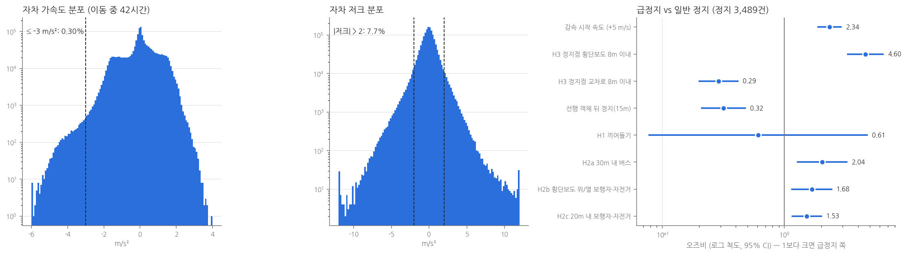
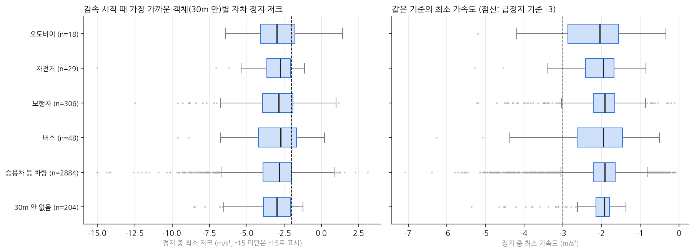
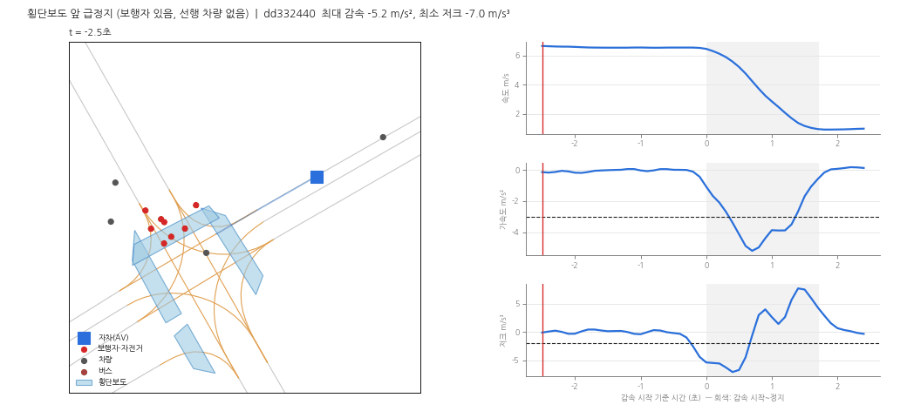
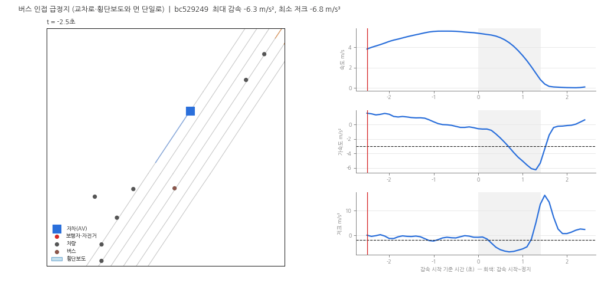
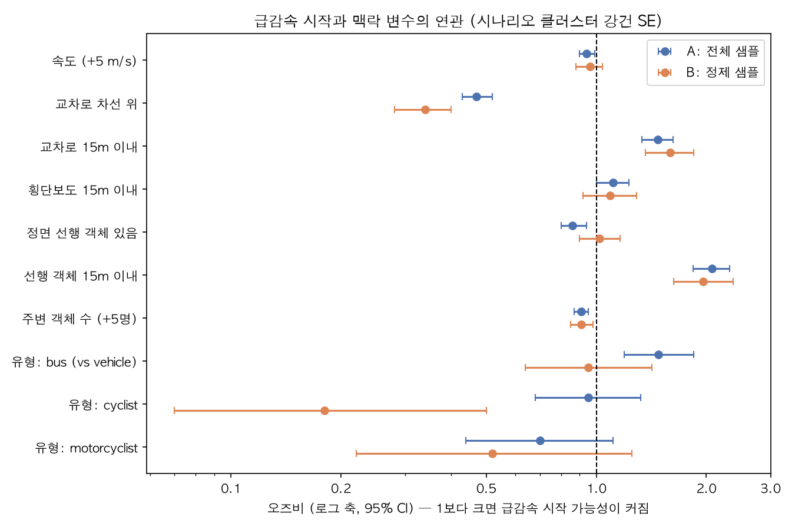
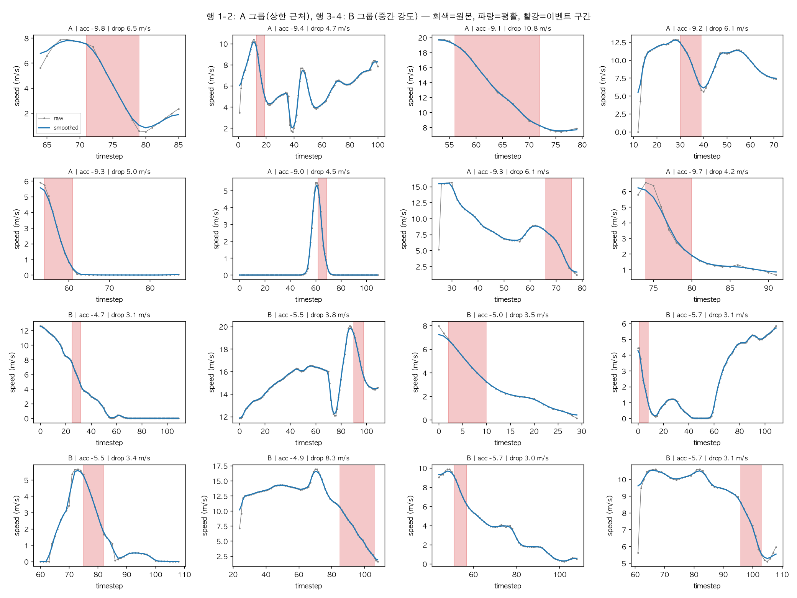
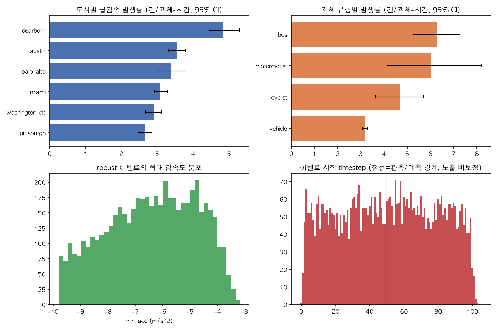

# Argoverse 2 급감속(Hard Braking) 분석

**자율주행 차량의 급정지는 어디서 일어나는가?** 

## 한눈에 보기

| 항목 | 내용 |
|---|---|
| 질문 | 자율주행 데이터 수집 차량(자차)은 어떤 상황에서 부드럽게 서지 못하고 급하게 서는가? |
| 데이터 | Argoverse 2 Motion Forecasting val 24,988개 시나리오 (10Hz, 시나리오당 11초) |
| 분석 규모 | 자차 정지 3,489건(급정지 287건) 비교, 노이즈 필터를 거친 주변 객체 급감속 이벤트 5,271건 |
| 방법 | 급정지 vs 일반 정지 비교, 로지스틱 회귀(오즈비·95% 신뢰구간), 대조군 비교, 노이즈 진단과 민감도 분석 |
| 도구 | Python (pandas, NumPy, pyarrow, matplotlib). 로지스틱 회귀와 클러스터 강건 표준오차는 NumPy로 직접 구현 |
| 형태 | 개인 미니 프로젝트. 분석 스크립트 16개(`src/`), 결과 표·그림(`outputs/`), 실행 순서(아래 "재현") 포함 |
| 읽는 순서 | 요약만 볼 때는 이 표, 아래 핵심 결과, 그림까지. 자세히 볼 때는 **1. 자차(AV) 주행 판단 분석**과 **한계**를 권장합니다. 2부는 접어 두었습니다. |

**핵심 결과**

- 앞차를 따라 멈출 때보다 **횡단보도 앞**에서 멈출 때 급정지가 많음 (횡단보도 앞 비율: 급정지 24%, 일반 정지 8%)
- 예상과 달리 끼어들기·점선→실선 구간에서는 급정지가 늘지 않음
- 결과를 왜곡하던 데이터 경계 오류·탐지 오탐을 직접 찾아 수정



자율주행 주행 판단(Planning & Prediction) 데이터 분석 직무 관심으로 진행한 미니 프로젝트입니다.
Argoverse 2 Motion Forecasting **val 24,988개 시나리오**(10Hz, 시나리오당 11초)에서 급감속 이벤트를 추출하고,
**어떤 맥락에서 급감속이 시작되는지**를 대조군 비교로 살펴봤습니다.

분석은 두 부분입니다.
1. **자차(AV) 주행 판단 분석** — 데이터 수집 차량 자신의 가속도·저크와 정지 방식을 지도·주변 객체와 묶어 봤습니다. 직무(Planning & Prediction)와 직접 맞닿은 부분입니다.
2. **주변 객체 전체 급감속 분석** — 자차가 관측한 모든 차량의 급감속 맥락(먼저 진행한 분석).

## 1. 자차(AV) 주행 판단 분석

**질문: 자차가 멈출 때, 어떤 상황에서 부드럽게 서지 못하고 급하게 서는가?**

### 먼저 확인한 것: 자차 데이터의 경계 왜곡
자차 궤적은 측위 기반이라 다른 객체보다 깨끗하지만(속도 필드와 위치 차분 속도의 차이 중앙값 약 0.04 m/s),
시나리오 **앞뒤 약 1초는 왜곡**돼 있었습니다. 첫 두 스텝의 속도 값은 모든 시나리오에서 같고, 위치로 계산한 속도도 경계에서 비현실적으로 오르내렸습니다.
처음에는 이 구간이 그대로 들어가 가속도 상·하위 0.1%가 ±13 m/s²까지 튀었고, 경계(타임스텝 0–9, 100–109)를 빼자 -3.9에서 +2.5 m/s² 사이로 정상 범위가 됐습니다.
기존 자차 급감속 184건 중 23건이 이 구간에 걸쳐 있었고, 그중 상당수가 '원인 설명 불가'로 분류돼 있었습니다(경계 제외 전 42건 중 10건). 이후 자차 분석은 모두 경계를 뺀 결과입니다.

### 깔때기 구조
| 단계 | 대상 | 결과 |
|---|---|---|
| 전체 분포 | 24,988개 시나리오, 이동 중 42.0시간 | 가속도 -3 m/s² 이하는 0.30%, \|저크\| > 2 m/s³는 7.7% |
| 정지 비교 | 정지 에피소드 3,489건 (급정지 287건, 8.2%) | 급정지는 제동 시간 2.5초·제동 거리 10.0 m로, 일반 정지(3.7초·12.8 m)보다 짧게 끊어 섬 |
| 사례 재구성 | 대표 사례 0.1초 단위 | 아래 그림 |

**정지끼리 비교한 이유**: 급감속 시점을 '아무 주행 시점'과 비교하면 "정지 직전이라서" 생기는 차이가 섞입니다(급감속 이벤트의 51%가 3초 안에 정지, 대조는 10%).
그래서 같은 '정지' 상황 안에서 급정지와 일반 정지를 비교했습니다.

### 가설 검증 (급정지 vs 일반 정지, 감속 시작 속도 보정 로지스틱 회귀)
| 가설 | 급정지 | 일반 정지 | OR (95% CI) | 판단 |
|---|---|---|---|---|
| H3 정지점이 횡단보도 8m 이내 | 23.7% | 8.2% | **4.60** (3.25–6.51) | 지지 |
| H2b 감속 시작 때 횡단보도 위/옆에 보행자·자전거 | 18.5% | 10.9% | 1.68 (1.14–2.47) | 지지 |
| H2a 감속 시작 때 30m 내 버스 | 8.4% | 4.2% | 2.04 (1.27–3.28) | 약하게 지지 (24건) |
| H1 옆 차로 차량 끼어들기 | 0.3% | 0.5% | 0.61 (0.08–4.82) | **검증 불가** (드묾) |
| H1 차선 경계가 점선→실선으로 바뀌는 구간(앞 40m) | 14.3% | 15.3% | 0.86 (0.57–1.31) | 지지 안 됨 |
| 참고: 선행 차량 뒤 정지(15m) | 19.2% | 27.6% | 0.32 (0.21–0.48) | 오히려 부드러움 |
| 참고: 정지점이 교차로 8m 이내 | 63.8% | 69.1% | 0.29 (0.20–0.42) | 횡단보도를 보정하면 부드러움 |

읽는 법 (분포와 오즈비 그림은 맨 위):
- **급정지는 '앞차를 따라 서는' 상황이 아니라 '횡단보도 앞에 서는' 상황과 묶여 있었습니다.** 선행 차량 뒤 정지는 오히려 급정지가 적었습니다.
- 횡단보도 앞 정지만 놓고 보면, 감속 시작 때 보행자·자전거가 횡단보도 위나 옆에 있던 비율이 급정지 42.6%, 일반 정지 28.4%였습니다. 보행자 없이도 급정지가 절반 이상이라 보행자만으로는 설명되지 않습니다.
- 교차로 변수는 횡단보도와 겹쳐 있어(횡단보도 앞 정지의 99.7%가 교차로 8m 이내) 단독 비율로는 차이가 작고, 횡단보도를 함께 넣으면 방향이 뒤집힙니다. "교차로라서 급정지"라고 말할 근거는 없습니다.
- 끼어들기는 처음 규칙(옆 차로 → 정면 통로)으로 6–7%가 잡혔는데, 확인해 보니 **자차가 휘어 도는 동안 정차 차량이 정면으로 '들어온 것처럼' 보인 오탐**이었습니다. 같은 방향으로 달리는 차량만 남기자 0.3–0.5%로 줄어 판단할 표본이 없었습니다.

### 차선 경계 타입 (H1 보완)
기획 단계 가설은 "점선이 실선으로 바뀌는 교차로 진입 구간에서 끼어들기 예측이 늦어 급감속이 많을 것"이었습니다.
감속 시작 때 자차가 달리던 차선(진행 방향 45도 이내, 3m 이내 중심선)의 좌우 경계를 지도에서 읽어 나눴습니다.

| 감속 시작 때 차선 경계 | 급정지 | 일반 정지 | 보정 OR (95% CI) |
|---|---|---|---|
| 점선(혼합 포함) 경계 있음 | 36.2% | 36.2% | 1.35 (0.96–1.90) |
| 실선만 | 32.1% | 44.4% | 기준 |
| 차선 표시 없음 | 31.4% | 19.3% | **2.02** (1.48–2.76) |
| 점선→실선 전환 구간 | 14.3% | 15.3% | 0.86 (0.57–1.31) |

보정 OR는 감속 시작 속도와 횡단보도 정지를 함께 넣은 로지스틱 회귀입니다. 차선 매칭은 3,489건 중 3,485건 성공했습니다.
- **점선→실선 전환 가설은 지지되지 않았습니다.** 급감속 이벤트 vs 대조 비교에서도 9.9% vs 12.8%(OR 0.77, 0.44–1.33)로 차이가 없었습니다. 앞의 끼어들기가 드물었던 결과와도 맞습니다.
- 대신 **차선 표시가 아예 없는 차선**에서 급정지가 약 2배였습니다. 이 차선 중 교차로 차선은 30.4%뿐이라 교차로 효과만으로는 설명되지 않습니다. 어떤 도로인지(주택가 도로, 주차장 진입로 등)는 지도에 도로 등급이 없어 확인하지 못했습니다.

### 최근접 객체 클래스별 저크 (H2 보완)
감속 시작 때 30m 안에서 가장 가까운 동적 객체의 클래스로 정지 에피소드를 나눴습니다.
다른 객체 자신의 저크는 트래킹 노이즈가 커서(2부 참고) 쓰지 않고, 측위 기반으로 깨끗한 자차 저크만 비교했습니다.

| 최근접 객체 | 정지 수 | 급정지 비율 (95% CI) | 최소 저크 중앙값 |
|---|---|---|---|
| 승용차 등 차량 | 2,884 | 7.7% (6.8–8.7) | -2.83 m/s³ |
| 30m 안 없음 | 204 | 7.4% (4.5–11.8) | -2.98 m/s³ |
| 보행자 | 306 | 10.8% (7.8–14.8) | -2.85 m/s³ |
| 버스 | 48 | 16.7% (8.7–29.6) | -2.72 m/s³ |
| 자전거 | 29 | 13.8% (5.5–30.6) | -2.74 m/s³ |
| 오토바이 | 18 | 27.8% (12.5–50.9) | -2.97 m/s³ |



- **전형적인 정지의 저크는 클래스와 상관없이 거의 같았습니다**(중앙값 -2.7에서 -3.0 m/s³). 기획안의 "대형차·보행자 옆에서 전반적으로 과감속" 그림과는 다릅니다.
- 차이는 꼬리에서 납니다. 버스·보행자가 가장 가까웠을 때 급정지 비율이 차량보다 높았고, 앞의 회귀(30m 안 버스 OR 2.04, 20m 안 보행자·자전거 OR 1.53)와 방향이 같습니다. 자전거·오토바이는 표본이 작아 신뢰구간이 넓습니다.
- 객체 클래스 목록에 **트럭이 없습니다**(AV2는 트럭을 vehicle에 포함). 그래서 기획안의 "버스/트럭" 중 버스만 볼 수 있었습니다.

### 급감속 이벤트 기준으로 본 결과 (이벤트 161건 vs 자차 대조 716개)
- 정면 선행 객체와의 TTC가 4초 미만이었던 비율: 18.6% vs 4.6% (OR 4.73, 2.80–8.00)
- TTC·교차로·횡단보도·보행자 규칙으로 설명되지 않는 이벤트 33건(20.5%). 다만 대조 시점도 70.5%가 같은 규칙에 걸려(OR 1.60) **지도 근접 규칙은 설명력이 약하고, TTC만 뚜렷하게 구분**했습니다.

### 사례 재구성


횡단보도에 보행자 여러 명이 있고 선행 차량은 없는 상황입니다. 감속 시작 1.5초 전, 자차가 횡단보도 중심선에서 14.5 m 떨어져 있을 때 이미 30m 안 횡단보도 주변에 보행자·자전거 5명이 보였습니다.
그런데 자차는 6.4 m/s를 유지하다 **횡단보도 중심선 4.8 m 앞에서야** 감속을 시작해 5.9 m·1.7초 만에 섰고, 최대 감속 -5.2 m/s², 최소 저크 -7.0 m/s³였습니다.
데이터로 말할 수 있는 건 "멈출 이유가 미리 보였는데 감속이 늦게 시작됐다"는 것까지입니다(보행자 의도 예측 결과는 데이터에 없음).



반대로 원인을 확정하지 못한 사례입니다. 교차로·횡단보도와 먼 단일로에서 -6.3 m/s²로 섰고, 옆 차로 앞쪽에 버스, 정지 후 20m 앞에 차량이 있었습니다.
AV2 지도에는 신호등 상태와 정지선이 없어서 이런 경우는 "데이터로 원인 확정 불가"로 남겼습니다.

### Planning & Prediction 관점의 제안
데이터가 보여 준 것에서 바로 이어지는 제안만 적었습니다. 실제 플래너 내부 로직은 데이터에 없으므로 검증된 개선안이 아니라 **확인해 볼 가설**입니다.
1. **횡단보도 접근 구간의 사전 감속 프로파일 점검.** 급정지는 횡단보도 앞 정지와 강하게 묶였고, 제동 시간이 일반 정지보다 1.2초 짧았습니다. 횡단보도 근처 보행자를 더 이른 시점에 '양보 대상'으로 예측하거나, 횡단보도 진입 전 목표 속도 상한을 두면 같은 정지를 낮은 저크로 만들 수 있는지 시뮬레이션으로 확인해 볼 만합니다.
2. **선행 차량 추종 정지는 이미 부드러움.** 급정지 줄이기의 우선순위는 차량 추종보다 지도 요소(횡단보도) 앞 정지 쪽에 두는 게 데이터와 맞습니다.
3. **승차감 지표를 정지 원인별로 모니터링.** 전체 급감속 비율 하나보다 '횡단보도 앞 / 선행 차량 뒤 / 기타' 정지별 급정지 비율을 따로 보면 회귀를 더 빨리 잡을 수 있습니다.

## 2. 주변 객체 전체 급감속 — 핵심 결과

<details>
<summary>펼쳐서 보기: 필터 강도를 바꿔도 유지된 결과와 불안정한 결과, 도시별 발생률</summary>

신뢰할 수 있는 것(필터 강도를 바꿔도 유지된 결과)과 그렇지 않은 것을 구분해 적었습니다.

| 구분 | 결과 |
|---|---|
| 유지됨 | 급감속은 **교차로 차선 위가 아니라 교차로 접근 구간(15m 이내)** 에서 시작되는 경향 (교차로 위 OR 0.47→0.34, 15m 이내 OR 1.47→1.59) |
| 유지됨 | **정면 15m 이내에 선행 객체**가 있으면 급감속 시작 가능성이 약 2배 (OR 2.07→1.96). 더 먼 선행 객체는 영향 없음 (OR 1.02) |
| 유지됨(약함) | 주변 객체가 많을수록 약간 낮음 (OR 0.91, 효과 작음) |
| 불안정 | 버스의 높은 발생률 (전체 OR 1.48, 정제 후 0.95), cyclist (정제 후 표본 작음), 횡단보도 근접 |
| 도시별 | 노출 시간 대비 발생률: Dearborn이 가장 높고(4.85) Pittsburgh가 가장 낮음(2.66). 중간 도시들은 신뢰구간이 겹침 |

OR는 "그 조건일 때 급감속이 시작될 상대적 가능성"입니다(1보다 크면 증가).



</details>

## 급감속 정의와 필터

속도(`velocity_x`, `velocity_y`의 크기)를 중앙값 필터(0.5초) → 이동평균(0.3초)으로 다듬고 미분해 가속도를 구했습니다.
가속도가 -3.0 m/s² 이하로 0.5초 이상 이어지고 시작 속도가 2 m/s 이상이면 후보 이벤트입니다.
대상은 vehicle, bus, motorcyclist, cyclist입니다(정지 물체 제외).

초기 결과에서 가속도가 -128 m/s²까지 나오는 등 **측정 노이즈로 보이는 이벤트가 많아** 단계별로 걸러 냈습니다.

| 단계 | 남은 건수 |
|---|---|
| 후보 이벤트 | 40,357 |
| 원본 속도가 한 스텝에 15 m/s² 넘게 튀는 구간 포함(glitch) 제외 | 27,255 |
| 물리적 제동 한계(-9.8 m/s²) 이내 | 25,209 |
| 속도 감소 3 m/s 이상 | 7,298 |
| 지속 0.7초 이상 (**robust 이벤트**) | **5,271** |

- 진단: 극단 이벤트의 원본 속도를 직접 찍어 보니 속도가 튀었다가 0으로 사라지는 트래킹 오류 패턴이었습니다 (`src/03_diagnose.py`).
- 검증: 이벤트를 무작위로 뽑아 원본/평활 속도를 그려 육안 확인했습니다 (`outputs/figures/event_samples.png`).

  

  지속 시간 0.7초 기준은 샘플 검토에서 0.5초대 짧은 펄스가 노이즈로 보여 추가했고, 그 뒤 샘플에서는 대부분 매끄러운 실제 제동이었습니다.
  다만 16건 단위 육안 검토에 기반한 판단이라 아래 한계에도 적었습니다.
- 민감도: 평균 가속도 기준(-3에서 -6 m/s²)과 속도 감소 기준(2–5 m/s)을 바꿔 가며 건수를 비교했습니다 (`outputs/tables/sensitivity_*.csv`).

## 분석 방법

1. **발생률**: 이벤트 수를 객체-시간(노출)으로 나눠 도시·객체 유형별로 비교했고, 시나리오 단위 부트스트랩으로 95% 신뢰구간을 계산했습니다.

   

2. **맥락 비교(case-control)**: 각 이벤트의 시작 시점과, 같은 시나리오에서 급감속이 없었던 주행 시점(이벤트당 2개, 이벤트 후보 앞뒤 3초 제외)을 비교했습니다.
   지도(차선 중심선·교차로 여부·횡단보도)와 주변 객체(선행 객체 거리, 30m 내 객체 수)에서 변수를 만들었고,
   로지스틱 회귀(시나리오 클러스터 강건 표준오차)로 속도와 다른 변수를 보정했습니다.
3. **정제 모델**: 트랙 시작 직후(15스텝 미만)와 직전 1.5초 내 4 m/s² 초과 가속이 있는 샘플을 양쪽 모두 제외한 모델(B)로 결과가 유지되는지 확인했습니다. 이 모델에는 이벤트의 약 31%(약 1,600건)만 남습니다.

## 3. 급정지 예측 실험 (PyTorch)

**질문: 감속을 시작하는 순간까지 알 수 있는 정보만으로, 이 정지가 급정지(최소 가속도 ≤ -3 m/s²)가 될지 미리 맞힐 수 있는가?**

앞의 분석이 "급정지가 어디서 일어났나"를 설명했다면, 여기서는 "미리 알 수 있나"를 PyTorch 모델로 확인했습니다.

### 설계
- **시나리오 단위 분할**: train/val/test(70/15/15)를 정지가 아니라 시나리오로 먼저 나누고, 급정지가 있는 시나리오와 없는 시나리오를 따로 섞었습니다(층화). 한 시나리오가 두 세트에 걸치지 않는지 코드에서 검사합니다. 공식 test는 뒤 6초 궤적이 숨겨져 있어 정지 라벨을 만들 수 없으므로, 받아 둔 val 안에서 다시 나눴습니다.
- **입력에서 뺀 값**: 라벨 정의에 쓰인 `min_acc`, 정지 이후에야 아는 값(정지 지점의 횡단보도·교차로 거리, 제동 시간·거리), 감속 시작 이후 구간까지 보는 끼어들기 변수.
- **누수 방지**: 평균·표준편차·범주 목록은 학습 데이터에서만 배우고(`Preprocessor.fit`), fold마다 다시 배웁니다.
- **불균형**: 급정지가 8.2%라 accuracy 대신 PR-AUC를 쓰고, 손실에 `pos_weight`를 넣었습니다.
- **모델**: 로지스틱 회귀(`nn.Linear` 1층)와 MLP(32유닛, 드롭아웃 0.2). 에폭은 30으로 미리 고정해 평가 fold를 보고 멈추는 시점을 고르지 않았습니다.

### 결과 (PR-AUC, 높을수록 좋음)
| 단계 | 로지스틱 회귀 | MLP | 무작위 |
|---|---|---|---|
| 5-fold 교차검증, 기본 특징 (train+val 2,965건, 급정지 244건) | 0.187 | 0.204 | 0.082 |
| 5-fold 교차검증, 이력 있는 정지 (1,450건, 급정지 154건): 기본 특징 | 0.246 | 0.247 | 0.106 |
| 위와 같음 + 감속 직전 1초 시계열 특징 | 0.333 | 0.382 | 0.106 |
| **test** (257건, 급정지 30건, 시드 10개 평균): 기본 특징 | 0.261 | 0.243 | 0.117 |
| **test**: + 시계열 특징 | 0.271 | 0.259 | 0.117 |

### 확인하고 바로잡은 것
- **val 한 번의 점수는 낙관적이었습니다.** 로지스틱 회귀의 val PR-AUC는 0.23~0.25였지만 5-fold 평균은 0.187이었습니다. val의 급정지가 43건뿐이라 점수가 에폭마다 크게 흔들리고, "val PR-AUC가 가장 높은 에폭"을 고르면 거의 학습되지 않은 1에폭이 뽑혔습니다. 조기 종료 기준을 val 손실로 바꾸고, 비교는 5-fold로 했습니다.
- **`pos_weight`는 순위를 바꾸지 않았습니다.** 넣고 뺀 두 모델의 PR-AUC는 오차 범위 안에서 같았습니다. 바뀐 것은 점수의 눈금입니다. 기준 0.5에서 재현율이 2.3%(1/43건)에서 62.8%로 올랐지만 정밀도는 17.5%였고, 기준값을 0.05~0.8로 움직이며 재현율과 정밀도가 맞바뀌는 것을 확인했습니다(val 523건).
- **모델을 바꿔도 거의 오르지 않았습니다.** 기본 특징에서 로지스틱 회귀 0.187, MLP 0.204로 차이가 작아 병목이 모델이 아니라 입력 정보라고 판단했고, 감속 직전 1초의 속도·가속도 변화(`dv_1s`, `acc_mean_1s`, `acc_min_1s`, `speed_std_1s`)를 추가했습니다.
- **시계열 특징은 이력이 있는 정지에만 만들 수 있습니다.** 시나리오 앞 1초를 왜곡 때문에 뺐으므로 3,489건 중 1,707건뿐이고, 이력 유무 자체가 급정지 비율과 엮여 있어(5% vs 11%) 이력이 없는 정지를 0으로 채워 섞지 않고 이력이 있는 정지끼리만 비교했습니다.
- **정보 누수 가능성을 점검했습니다.** 속도가 평활화되어 있어 감속 시작 바로 앞 값에 시작 이후 정보가 섞일 수 있으므로, 시작 3·5·8스텝 전에서 끊어 비교했고 교차검증의 개선은 모두 유지됐습니다(MLP +0.08~+0.14).

### 해석과 한계
- **교차검증의 개선은 test에서 확인되지 않았습니다.** 시계열 특징을 넣으면 5-fold에서는 모든 fold가 올랐지만(MLP 0.247 → 0.382), test에서는 +0.01대(로지스틱 +0.013, MLP +0.016)였고 부트스트랩 95% 구간이 0을 포함합니다(로지스틱 [-0.060, +0.097], MLP [-0.068, +0.119]). test의 급정지가 30건뿐이라 점수 하나가 건수 몇 개에 크게 흔들립니다. 효과가 없다고도, 있다고도 결론내지 않았습니다. 구분하려면 급정지 사례를 더 확보해야 합니다.
- 어떤 모델이든 무작위보다는 높습니다(test 약 2.1~2.3배). 점수 상위 20%에 경보를 울리면 급정지 30건 중 11건을 잡았고 정밀도는 0.216(무작위 0.117)이었습니다. 선별 도구로 쓰기에는 약합니다.
- 신호등 상태·정지선 정보가 데이터에 없고, 시계열 특징은 정지의 절반에만 만들 수 있으며, 속도·가속도는 이미 평활화된 값입니다.
- 간격(3·5·8스텝)은 교차검증 결과를 보고 비교했으므로 교차검증 점수는 다소 낙관적일 수 있습니다.

## 한계

- **AV2의 자차는 데이터 수집 차량입니다.** 수집 당시 자율주행 모드였는지 사람이 운전했는지는 데이터셋이 밝히지 않으므로, 자차 결과를 특정 자율주행 소프트웨어의 판단 품질로 해석하지 않았습니다.
- 자차 분석은 시나리오 앞뒤 1초를 뺐고, 정지 에피소드는 감속 시작이 이 구간 안에 있어야 잡히므로 긴 정지 과정 일부는 빠집니다.
- 횡단보도 거리는 자차 중심과 횡단보도 중심선 사이 거리라, 차 길이·정지 위치에 따라 오차가 있습니다. 끼어들기·버스 근접은 규칙 기반 근사이고, 끼어들기 규칙은 오탐을 한 번 고쳤지만 대규모 육안 검증은 하지 않았습니다.
- 급정지 vs 일반 정지 비교에서 시나리오 대부분은 정지가 1건이라 클러스터 보정 효과는 작습니다.
- **시나리오가 일반 주행의 무작위 표본이 아닙니다.** Argoverse 2 Motion Forecasting은 주행 로그 중 어렵거나 흥미로운 상호작용이 있는 구간을 골라 만든 데이터라, 여기서 나온 발생률을 일반 주행 전체의 급감속 빈도로 해석할 수 없습니다.
- **절대 발생률은 정의에 크게 의존합니다.** 기준을 바꾸면 객체-시간당 0.17–11.2건까지 달라집니다. 도시·유형·맥락 간 **상대 비교**만 결과로 사용했습니다.
- **노이즈가 완전히 제거되지는 않았습니다.** 이벤트의 37–48%가 트랙 시작 직후, 26–35%가 직전 급가속 구간에 있어 대조군(각 27–29%, 7–11%)보다 많았습니다. 트래킹 노이즈일 수도, 정차 후 출발해 곧 제동하는 실제 정체 주행일 수도 있어 데이터만으로는 구분하지 못했습니다. 그래서 정제 모델과 결과를 함께 보고, 두 모델에서 유지된 결과만 핵심 결과로 적었습니다.
- 버스·cyclist 관련 결과는 정제 후 달라지거나 표본이 작아 단정하지 않았습니다.
- 대조군을 같은 시나리오에서 뽑았으므로 **도시별 OR은 설계상 해석할 수 없습니다**(도시 차이는 발생률 분석만 사용).
- 선행 객체는 진행 방향 정면 직선 시야(앞 50m, 옆 2m 이내) 기준이라 곡선 구간에서 놓칠 수 있고, 거리는 객체 중심 간 거리입니다. 교차로 위 여부는 가장 가까운 차선 중심선 기준의 근사입니다.
- 연관 분석이며 **인과를 주장하지 않습니다.** 도시 차이도 운전 습관이 아니라 도로 구조·교통 환경·수집 구간 차이일 수 있습니다.
- val split(24,988 시나리오)만 사용했습니다. 속도 값은 데이터가 제공하는 `velocity` 필드를 그대로 썼습니다.

## 재현

```bash
python3 -m venv .venv && source .venv/bin/activate
bash setup_and_download.sh          # 환경 설치 + val 데이터 다운로드
python src/01_inspect.py            # 스키마 확인
python src/02_extract_events.py     # 후보 이벤트 추출
python src/03_diagnose.py           # 노이즈 진단
python src/04_analysis.py           # 필터 깔때기, 민감도, 발생률 + 신뢰구간
python src/05_inspect_samples.py    # 이벤트 육안 검증 그림
python src/06_context_features.py   # 맥락 변수(지도·주변 객체)
python src/07_context_analysis.py   # 이벤트 vs 대조 비교, 로지스틱 회귀
python src/08_forest_plot.py        # OR 포레스트 그림
python src/09_ego_check.py          # 자차 분석 가능성 점검 (경계 1초 제외)
python src/10_ego_analysis.py       # 자차 급감속 설명 분류, 자차 대조 비교 (경계 1초 제외)
python src/11_ego_cases.py          # 이벤트 후 3초 행동, 사례 그림
python src/12_stop_points.py        # 급감속 후 정지 지점
python src/13_ego_kinematics.py     # 자차 가속도·저크 분포, 정지 에피소드(급정지/일반) 추출
python src/14_ego_hypotheses.py     # H1~H3 검증 (끼어들기, 버스·보행자, 횡단보도·교차로)
python src/15_ego_figures.py        # 자차 개요 그림, 사례 GIF
python src/16_lane_marks_class_jerk.py  # 차선 경계 타입(점선/실선), 최근접 객체 클래스별 저크

# 급정지 예측 실험 (PyTorch)
python src/split_data.py            # 시나리오 단위 train/val/test 분할 + 5-fold 번호
python src/train_logreg.py          # 로지스틱 회귀 기준선 (val 평가)
python src/train_cv.py              # 로지스틱 회귀 vs MLP, 5-fold 교차검증
python src/make_ts_features.py      # 감속 직전 1초 시계열 특징
python src/train_cv_ts.py           # 시계열 특징 추가 효과, 5-fold 교차검증
python src/eval_test.py             # test 최종 평가 (설정을 확정한 뒤 한 번만)
```

폴더: `src/` 스크립트, `outputs/tables/` 표, `outputs/figures/` 그림, `data/` 원본(git 제외)
